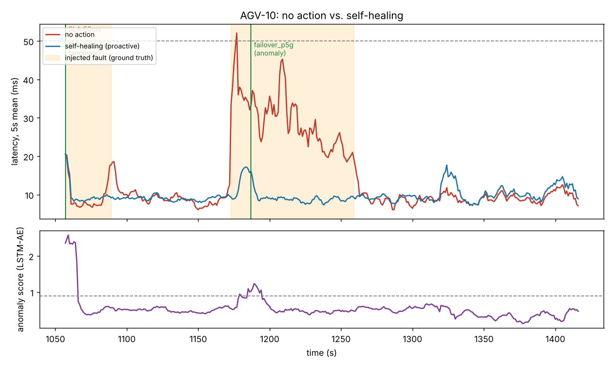

# Factory Wireless AIOps

공장 AGV 무선망을 대상으로 **품질 이상 탐지 → 장애 예측 → 원인 진단 → 자율 조치(Self-Healing)** 를 하나의 스트리밍 파이프라인으로 구현한 개인 프로젝트입니다.
실제 공장 데이터 대신, 경로손실·로밍·간섭·AP 혼잡을 모델링한 시뮬레이터로 데이터를 만들었습니다.

```
 시뮬레이터(AGV 20대, 1초)          탐지 서비스                                   모니터링
 ┌───────────────┐  telemetry   ┌──────────────────────────────────┐  /metrics  ┌────────────┐
 │ RSSI·SINR·지연 │ ───Kafka───▶ │ LSTM-AE 이상 탐지                  │ ─────────▶ │ Prometheus │──▶ Grafana
 │ 손실·AP 사용률  │              │ Transformer 지연 예측 (p50/p90)    │            └────────────┘
 │ 장애 주입       │ ◀──Kafka──── │ 룰 기반 원인 진단 → 조치 결정        │
 └───────────────┘   actions    └──────────────────────────────────┘
   채널 전환 · 부하 분산 로밍 · P-5G 이중화 전환
```

## 결과 (학습에 쓰지 않은 2시간 시나리오, AGV 20대)

**이상 탐지** (주입 장애 122건)

| 방법 | F1 | 장애 탐지율 | 탐지 지연(중앙값) | 오경보/AGV·시간 |
| --- | --- | --- | --- | --- |
| LSTM AutoEncoder | **0.68** | **80%** | **2초** | 2.3 |
| Isolation Forest | 0.63 | 79% | 4.5초 | 1.6 |
| 고정 임계값 룰 | 0.57 | 66% | 4초 | 0.9 |

**원인 진단 룰**: 탐지된 장애 98건 중 91.8% 정확 (간섭 / AP 혼잡 / AP 출력 저하)

**지연 예측** (향후 10초, MAE)

| 방법 | 전체 | 지연 급변 구간 |
| --- | --- | --- |
| 현재값 유지 | 1.61ms | 8.90ms |
| Ridge 회귀 | 1.40ms | **6.33ms** |
| Transformer (p50) | **1.26ms** | 6.47ms |

p90 예측 구간의 실제 포함률 91.4%. SLA 위반(5초 평균 지연 > 50ms) 68건 중 98.5%를 발생 전에 경보, 중앙값 5초 선행.

**자율 조치 효과** (SLA 위반 = 5초 평균 지연 > 50ms 또는 손실 > 5%)

| 방식 | SLA 위반 (AGV·초) | 감소율 |
| --- | --- | --- |
| 조치 없음 | 2,125 | - |
| 탐지 기반 조치 | **505** | **76%** |
| 탐지 + 예측 기반 선제 조치 | 650 | 69% |

20대 AGV 전체 1초 틱 처리 시간(CPU) 중앙값 3.4ms.



## 한계와 다음 과제

- **조치의 약 80%가 실제 장애가 없는 상황에서 발생**했습니다. 오경보(AGV당 시간당 2.3회)가 그대로 조치로 이어지기 때문이며, 시뮬레이터 상 불필요한 조치의 비용이 0이라 SLA 수치에는 드러나지 않습니다. 실제 현장이라면 가장 먼저 고쳐야 할 부분입니다.
- 예측 기반 선제 조치는 오히려 결과가 나빴습니다(69% < 76%). 경보의 선행 시간이 짧고(중앙값 5초) 오경보가 많아서로 보입니다.
- 지연 급변 구간에서는 Transformer가 Ridge보다 낫지 않았습니다.
- 개선 방향: 조치 비용을 반영한 경보 임계값 조정, AP 단위로 알람을 묶는 토폴로지 기반 진단, 운영 로그로 학습하는 오프라인 강화학습 정책.
- 모든 데이터는 시뮬레이션이며, 실제 무선 환경의 복잡도(다중경로, 이동 장애물, 단말별 로밍 정책)는 단순화했습니다.

## 실행

```bash
pip install -r requirements.txt
cd src
python train.py              # 데이터 생성·학습·평가 (CPU 약 12분) -> artifacts/
python evaluate_healing.py   # 자율 조치 효과 평가 -> artifacts/healing_metrics.json

# Docker 없이 바로 보기: 시뮬레이터 내장 실행 + Prometheus 지표(:8000/metrics)
python detector_service.py --local --speed 10

# 전체 스택: Kafka + 시뮬레이터 + 탐지 서비스 + Prometheus + Grafana
cd .. && docker compose up --build      # Grafana http://localhost:3000

python tests/test_kafka_flow.py         # 브로커 없이 Kafka 메시지 왕복 검증
```

## 구성

| 파일 | 역할 |
| --- | --- |
| `src/simulator.py` | AGV 이동, AP 로밍, 경로손실, 간섭·혼잡·출력저하 주입, 제어 명령 반영 |
| `src/models.py` | LSTM AutoEncoder, Transformer 분위수 예측 모델 |
| `src/engine.py` | 온라인 탐지·예측·원인 진단 룰·조치 정책 |
| `src/train.py` | 학습과 오프라인 평가 (베이스라인 비교 포함) |
| `src/evaluate_healing.py` | 조치 없음 / 탐지 기반 / 예측 포함 비교 |
| `src/producer.py`, `src/detector_service.py` | Kafka 발행·구독, Prometheus exporter |
| `grafana/`, `prometheus/`, `docker-compose.yml` | 모니터링 스택 |

시나리오 분리: 정상 2시간(이상 탐지 학습), 장애 포함 3시간(예측 학습, 진단 룰 설계), 장애 포함 2시간(평가 전용).
